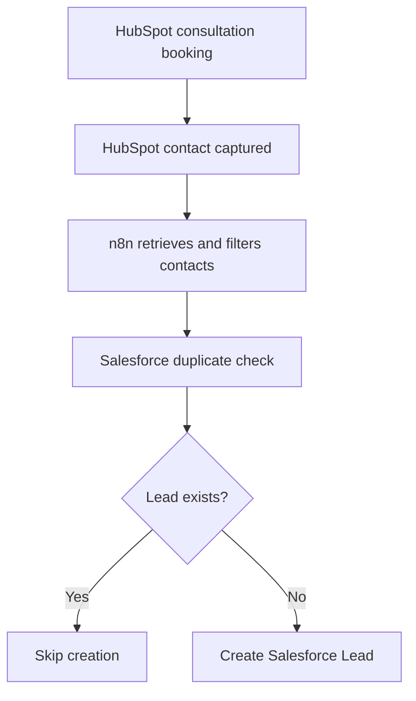

# Consultation Lead Capture & CRM Integration

**HubSpot Meetings → Google Calendar → n8n → Salesforce**

**Project type:** CRM Integration & Revenue Operations Automation  
**Status:** Functional MVP — successfully tested  
**Environment:** HubSpot Free, n8n (Docker), Salesforce Developer Edition

## 1. Business Case

### Business Problem

Organizations often use different systems for appointment scheduling, marketing, and sales management.

For example, a prospective customer books a consultation through HubSpot, but the sales team manages opportunities in Salesforce.

Without integration, the handoff may involve manually copying contact information between platforms.

This introduces several operational risks:

- Delayed follow-up with prospective customers
- Duplicate CRM records
- Inconsistent customer information
- Additional administrative work
- Limited visibility across the customer journey

### Business Objective

Design and test a CRM integration that reduces manual lead handoff, supports data consistency, and prevents duplicate Lead creation.

### Business Questions

1. How can consultation bookings capture customer information automatically?
2. How can contact data be retrieved from HubSpot?
3. How can HubSpot fields be mapped to Salesforce Lead fields?
4. How can Salesforce be checked for an existing Lead?
5. How can the workflow create a Lead only when no matching record exists?
6. How can the integration be tested and validated?

### Success Criteria

| Requirement | Expected Outcome |
|---|---|
| Lead capture | Consultation booking creates a HubSpot contact |
| Data retrieval | n8n retrieves HubSpot contact information |
| Data mapping | Contact information is mapped to Salesforce fields |
| Duplicate check | Salesforce is queried using the contact email |
| Lead creation | New Lead created when no matching Lead exists |
| Duplicate prevention | Existing Lead detected and creation skipped |

## 2. Solution Architecture

The solution combines consultation scheduling, CRM data retrieval, conditional logic, and Salesforce REST API operations.


**Booking and lead capture:**

Prospect → HubSpot Meetings → Google Calendar booking integration → HubSpot Contact

**CRM handoff:**

Manual Trigger → HubSpot Get Many Contacts → Filter → Salesforce GET (SOQL) → IF

- **True:** No matching Lead exists → Salesforce POST → Create Lead
- **False:** Matching Lead exists → Skip creation

The workflow uses a manual trigger and a test-contact filter for the current MVP. It does not yet automatically identify every new consultation booking.

## 3. HubSpot Lead Capture

### Configuration

1. Configured a consultation booking link using HubSpot Meetings.
2. Connected the scheduling process with Google Calendar.
3. Submitted a fictional consultation booking to test the capture process.
4. Verified that the booking resulted in a HubSpot contact record.

### Business Value

HubSpot provides a structured entry point for consultation enquiries, reducing the need to manually collect contact information.

### Integration Access

Created a HubSpot Service Key with the permission:

`crm.objects.contacts.read`

This enabled authenticated retrieval of contact records through n8n.

## 4. n8n Workflow Implementation

### Node 1 — Manual Trigger

Starts the workflow for controlled testing.

### Node 2 — HubSpot: Get Many Contacts

Retrieves contact records from HubSpot using the configured Service Key.

**Test result:** 42 contacts retrieved.

### Node 3 — Filter

Filters the returned contacts to retain the fictional test record based on its email identity.

**Test result:** 1 record retained; 41 records excluded.

This is a test-specific filter and must be replaced with booking-based selection logic for a general-purpose solution.

### Node 4 — Salesforce HTTP GET: Duplicate Check

Uses the Salesforce REST API and SOQL to determine whether a Lead already exists with the contact's email address.

**HTTP method:** GET

**Endpoint:**

`/services/data/v61.0/query`

**SOQL template:**

```sql
SELECT Id, Email
FROM Lead
WHERE Email = 'test@example.com'
LIMIT 1
```

The email value is dynamically obtained from the filtered HubSpot contact.

**Initial response:**

```json
{
  "totalSize": 0,
  "done": true,
  "records": []
}
```

This indicates that no matching Salesforce Lead was found.

### Node 5 — IF: Conditional Logic

Evaluates the number of matching Salesforce Leads.

**Condition:** `totalSize` equals `0`

- **True:** Proceed with Lead creation
- **False:** Skip Lead creation

### Node 6 — Salesforce HTTP POST: Create Lead

**HTTP method:** POST

**Endpoint:**

`/services/data/v61.0/sobjects/Lead`

**Example request body:**

```json
{
  "Company": "Individual",
  "FirstName": "Test",
  "LastName": "Contact",
  "Email": "test@example.com"
}
```

The actual workflow maps these values dynamically from the filtered HubSpot contact.

The `Company` field uses `Individual` as a fallback because Salesforce requires a Company value when creating a Lead.

### Authentication

The Salesforce API requests use OAuth 2.0 with PKCE through n8n's HTTP Request node.

An existing OAuth credential configured for the Salesforce External Client App was reused successfully.

No access tokens or client secrets are included in this documentation.

## 5. Data Mapping

| HubSpot Source | Salesforce Destination | Mapping |
|---|---|---|
| First name | Lead.FirstName | Direct |
| Last name | Lead.LastName | Direct |
| Email identity | Lead.Email | Extracted from contact identity data |
| Company | Lead.Company | HubSpot company or `Individual` fallback |

## 6. Testing & Validation

### Test 1 — New Lead Creation

**Scenario:** Consultation contact does not exist as a Salesforce Lead.

**Expected:** Create a new Lead.

**Observed:**
- Salesforce GET returned `totalSize: 0`
- IF followed the True branch
- Salesforce POST returned `success: true`
- New Lead was verified in the Salesforce interface

**Result:** PASS

### Test 2 — Duplicate Prevention

**Scenario:** The same HubSpot contact is processed again.

**Expected:** Existing Lead is detected and another Lead is not created.

**Observed:**
- Salesforce duplicate check identified an existing Lead
- IF followed the False branch
- Lead creation was skipped

**Result:** PASS

## 7. Technical Challenges & Resolution

### Salesforce Authentication

The Salesforce External Client App required PKCE-compatible OAuth authentication.

**Resolution:** Used an existing working OAuth2 API credential in n8n's HTTP Request nodes.

### Required Salesforce Fields

The initial Lead creation request failed because the Salesforce Developer Edition contained additional required custom fields.

**Resolution:** Adjusted the custom field requirements in the test environment and retried the request successfully.

### Duplicate Prevention

A direct POST request could create duplicate Lead records.

**Resolution:** Added a Salesforce SOQL query and an IF condition before Lead creation.

## 8. Limitations

The current MVP has several limitations:

- The workflow is manually triggered.
- Contact filtering uses a specific fictional test email.
- The duplicate check searches Salesforce Leads by email, not Contacts.
- The workflow does not yet capture booking metadata or update existing records.
- Error handling, retries, monitoring, and booking-event detection require further development.
- Email matching alone is not sufficient to guarantee duplicate prevention in every production scenario.

## 9. Future Improvements

1. Introduce scheduled polling or a supported event-based booking trigger.
2. Identify consultation bookings dynamically.
3. Map booking date, consultation type, and source attribution.
4. Check both Salesforce Leads and Contacts.
5. Add error handling, logging, and notifications.
6. Introduce data validation and more robust duplicate management.
7. Measure lead handoff time, data completeness, and duplicate rates.

## 10. Skills Demonstrated

**Business Analysis:** Business problem definition, requirements, success criteria, process mapping

**HubSpot:** CRM contact management, consultation scheduling, Service Key configuration

**n8n:** Workflow orchestration, filtering, conditional logic, API integration

**Salesforce:** Lead management, REST API, SOQL, data mapping, duplicate checks

**Technical:** OAuth 2.0 / PKCE, JSON, HTTP GET/POST, API testing, troubleshooting

## 11. Evidence & Supporting Files

Sanitized workflow exports, code examples, and test screenshots will be added separately.

All credentials, access tokens, private contact information, and account-specific identifiers must be removed before publication.
