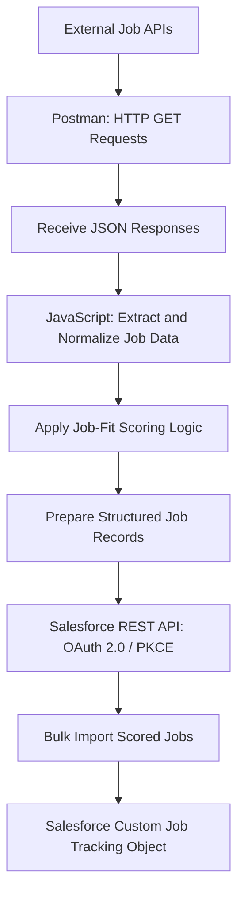

# Job Intelligence Engine

**Postman · REST APIs · JavaScript · JSON · OAuth 2.0 / PKCE · Salesforce**

**Project type:** API Integration, Data Processing & CRM Automation  
**Status:** Functional prototype — implemented, tested, and documented; further enhancements in progress

## 1. Business Case

### Business Problem

Job opportunities are distributed across multiple recruitment platforms, making it difficult to consolidate, compare, and prioritize relevant vacancies.

Manual job searching presents several operational challenges:

- Fragmented information across multiple recruitment platforms
- Inconsistent job descriptions and data structures
- Difficulty evaluating opportunities against predefined skills and criteria
- Repetitive manual data collection and entry
- Limited visibility into previously identified opportunities

### Business Objective

Develop and validate a job intelligence solution that retrieves job opportunities through external APIs, standardizes and scores the retrieved data, and transfers structured job records into Salesforce for centralized tracking.

### Key Business Questions

1. How can job opportunities from multiple sources be retrieved programmatically?
2. How can different API responses be transformed into a consistent data structure?
3. How can job opportunities be evaluated and scored against predefined criteria?
4. How can structured job records be imported into Salesforce?
5. How can API integration and data processing reduce repetitive manual work?

## 2. Solution Overview

Developed and tested an API-based job intelligence prototype using Postman, JavaScript, and Salesforce.

The solution retrieves job data from external APIs, processes and standardizes the responses, applies job-fit scoring logic, and transfers structured records into a custom Salesforce object.

### Implemented Capabilities

- Configured and executed job-search API requests in Postman.
- Worked with HTTP methods, query parameters, headers, JSON responses, and API testing.
- Developed JavaScript logic to extract, normalize, and score job opportunities.
- Implemented job-fit scoring based on predefined criteria.
- Configured and successfully authenticated Salesforce REST API access using OAuth 2.0 with PKCE.
- Created a custom Salesforce object to store and track job opportunities.
- Successfully imported structured, scored job records into Salesforce.
- Executed API tests and validated integration results.
- Documented the solution and published a sanitized Postman collection on GitHub.

## 3. Technical Architecture

The following diagram illustrates the implemented API retrieval, data processing, scoring, and Salesforce integration workflow.

## 4. Technologies

| Technology | Implementation |
|---|---|
| Postman | API request configuration, execution, testing, and collections |
| REST APIs | Retrieval of external job data and integration with Salesforce |
| JavaScript | Data extraction, normalization, transformation, and job-fit scoring |
| JSON | Structured data exchange and processing |
| OAuth 2.0 / PKCE | Secure Salesforce API authentication |
| Salesforce | Custom object configuration, job record storage, and tracking |
| GitHub | Source control, project documentation, and sanitized technical artifacts |

## 5. Testing and Results

### Verified Outcomes

- Successfully executed external job-search API requests.
- Retrieved and processed JSON responses from job data sources.
- Developed and tested JavaScript-based job-fit scoring logic.
- Successfully authenticated Salesforce API requests using OAuth 2.0 / PKCE.
- Completed API tests with passing results.
- Successfully imported structured job records into a Salesforce custom object.
- Verified the Salesforce integration and data import process.

### Business Outcomes Demonstrated

The prototype demonstrates how API integration and structured data processing can:

- Consolidate job information from multiple external sources.
- Standardize data for more consistent evaluation.
- Support prioritization through predefined job-fit scoring.
- Reduce the need to manually re-enter job information into Salesforce.
- Establish a foundation for centralized job opportunity tracking.

These outcomes demonstrate technical feasibility. Quantified time savings and improvements in job-search effectiveness have not yet been measured.

## 6. Current Limitations and Future Improvements

The implemented prototype supports API-based retrieval, data processing, scoring, and Salesforce record creation.

Further enhancements are planned to improve automation, reliability, and reporting.

### Future Improvements

1. **Scheduled data retrieval:** Automate API execution at defined intervals.
2. **Duplicate detection:** Identify previously imported opportunities to prevent duplicate Salesforce records.
3. **Automated updates:** Refresh existing records when job information changes.
4. **Scoring calibration:** Refine scoring criteria and weighting based on evaluation results.
5. **Data quality:** Strengthen validation, error handling, and response normalization.
6. **Reporting and analytics:** Develop Salesforce reports and dashboards to monitor opportunities by role, location, source, and fit score.
7. **Workflow orchestration:** Explore integration with automation tools to reduce manual execution steps.

## 7. Portfolio Artifacts

The following artifacts have been completed and published in the GitHub repository:

- **Project README:** Documents the business case, solution design, implementation, technologies, testing results, and future improvements.
- **Technical architecture:** Mermaid flowchart illustrating the API retrieval, processing, scoring, and Salesforce integration sequence.
- **Sanitized Postman collection:** Exported and published as `job-intelligence-engine-sanitized.postman_collection.json`.
- **JavaScript implementation:** Job data processing and scoring logic contained within the Postman collection.
- **Testing documentation:** Verified API and Salesforce integration outcomes recorded in this README.

### Security and Data Protection

The published Postman collection was sanitized before upload. Active API credentials, access tokens, and private authentication secrets were excluded from the shared artifact.

## 8. Skills Demonstrated

**Business Analysis:** Problem definition, business requirements, process improvement, success criteria, and solution design

**API Integration:** REST APIs, HTTP methods, authentication, request configuration, and response handling

**Data Processing:** JSON transformation, normalization, JavaScript, and rule-based scoring

**Salesforce:** Custom object configuration, REST API integration, record creation, and data management

**Testing and Troubleshooting:** API validation, response inspection, test execution, and integration troubleshooting

**Technical Documentation:** GitHub, Postman collections, Mermaid architecture diagrams, and implementation documentation

---

**Project status:** Functional prototype successfully implemented, tested, documented, and published on GitHub. Additional automation and reporting capabilities remain under development.
