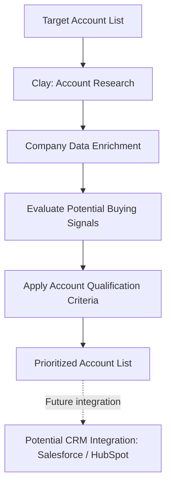

# Account Intelligence & Sales Research

**Clay · Account Research · Data Enrichment · Buying Signals · Revenue Operations**

**Project type:** GTM Intelligence & Sales Research  
**Status:** Exploratory project — development in progress

## 1. Business Case

### Business Problem

Sales and Revenue Operations teams often work with incomplete account information, making it difficult to identify high-priority prospects and understand when organizations may be ready to buy.

Common challenges include:

- Incomplete or outdated account data
- Time-consuming manual company research
- Difficulty identifying relevant decision-makers
- Limited visibility into potential buying signals
- Inconsistent account qualification and prioritization

### Business Objective

Explore how Clay can support structured account research, data enrichment, and buying-signal analysis to improve sales qualification and prioritization.

### Key Business Questions

1. What information is needed to qualify a target account?
2. How can company and contact information be enriched using external data?
3. Which signals might indicate potential demand for a product or service?
4. How can account research be standardized and made repeatable?
5. How could enriched account information support CRM workflows and sales prioritization?

## 2. Solution Overview

This project explores the use of Clay as an account intelligence and enrichment platform.

The intended workflow combines account research, data enrichment, signal evaluation, and structured qualification.

### Areas of Exploration

- Identifying relevant target accounts
- Researching company characteristics and business context
- Exploring enrichment capabilities
- Defining potential buying signals
- Considering how account intelligence could support Salesforce and HubSpot processes

These are exploration areas rather than claims of completed automated integrations.

## 3. Conceptual Architecture

The following diagram represents the proposed account intelligence workflow.

## 4. Technologies and Concepts

| Technology / Concept | Application |
|---|---|
| Clay | Account research and enrichment exploration |
| Firmographic Data | Company characteristics and account qualification |
| Buying Signals | Identifying indicators of potential customer demand |
| Data Enrichment | Improving account information completeness |
| Salesforce / HubSpot | Potential destinations for enriched account data |
| GitHub | Project documentation and version tracking |

## 5. Business Value Hypotheses

A structured account intelligence process could help sales teams:

- Reduce time spent on repetitive account research
- Improve the completeness of account information
- Prioritize prospects using consistent criteria
- Identify relevant signals for sales outreach
- Support better alignment between marketing and sales

These are potential benefits that have not yet been quantified or validated through end-to-end testing.

## 6. Current Status and Limitations

This project is in its exploratory stage.

A complete account enrichment pipeline, automated buying-signal detection, CRM synchronization, and measurable business outcomes have not yet been demonstrated in this portfolio.

## 7. Next Steps

1. Define a specific target customer profile.
2. Create a fictional or appropriately sourced test account list.
3. Build and document a Clay enrichment table.
4. Define measurable account qualification criteria.
5. Test selected buying-signal hypotheses.
6. Evaluate enriched data quality and coverage.
7. Explore Salesforce or HubSpot integration.
8. Document test results and technical limitations.

## 8. Skills and Knowledge Areas

**GTM Research:** Target account identification, qualification criteria, and sales prioritization

**Data Enrichment:** Firmographic information, data completeness, and research workflows

**Revenue Operations:** Account intelligence, CRM data quality, and sales process alignment

**Business Analysis:** Problem definition, process design, hypotheses, and evaluation criteria

## 9. Portfolio Artifacts

**Published:** Business case, conceptual architecture, and project development roadmap.

**Planned:** Sanitized Clay table examples, enrichment configuration, sample data, and documented test results.

No credentials, private contact information, or confidential account data should be included in published artifacts.
