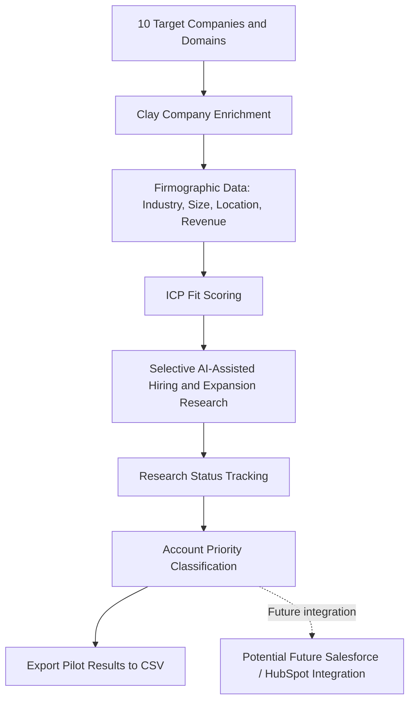

# Account Intelligence & Sales Research

**Clay · Company Enrichment · AI-Assisted Research · ICP Scoring · Buying Signals · Revenue Operations**

**Project type:** GTM Account Intelligence, Data Enrichment & Sales Prioritization  
**Status:** Working prototype — implemented, tested, and documented  
**Pilot scope:** 10 target companies

## 1. Business Case

### Business Problem

Sales and Revenue Operations teams often work with incomplete company information, making it difficult to identify high-priority accounts and recognize potential buying signals.

Common operational challenges include:

- Incomplete or outdated company information
- Time-consuming manual account research
- Inconsistent account qualification criteria
- Limited visibility into potential buying signals
- Difficulty prioritizing accounts for sales engagement
- High research costs when enrichment and AI research are executed indiscriminately

### Business Objective

Build and test a GTM Account Intelligence workflow using Clay to enrich company data, research potential buying signals, calculate Ideal Customer Profile (ICP) fit scores, and prioritize target accounts.

The pilot focused on 10 companies to demonstrate a structured, cost-conscious approach to account qualification.

### Key Business Questions

1. How can company information be enriched from a basic company name and domain?
2. Which firmographic characteristics are useful for ICP qualification?
3. How can recent hiring or expansion activity be researched as a potential buying signal?
4. How can accounts be scored and prioritized consistently?
5. How can AI-assisted research be applied selectively to manage costs?
6. How could qualified account data support downstream CRM and sales processes?

## 2. Solution Overview

Built and tested a GTM Account Intelligence prototype in Clay, combining company enrichment, AI-assisted research, ICP fit scoring, and account prioritization.

The workflow started with a defined sample of 10 target companies and their domains.

### Implemented Capabilities

- Created a company research table in Clay.
- Populated the pilot with 10 target companies and their domains.
- Configured company enrichment to retrieve firmographic information.
- Retrieved company names, websites, employee counts, industries, locations, descriptions, LinkedIn URLs, and estimated annual revenue ranges.
- Configured AI-assisted research into recent hiring or expansion activity as potential buying signals.
- Executed hiring research selectively to manage Clay credit consumption.
- Developed ICP fit scoring based on company characteristics, including industry and employee count.
- Calculated ICP fit scores to support account qualification.
- Introduced a research status field to distinguish researched from unresearched accounts.
- Applied account priority classifications, including provisional classifications where further research was required.
- Exported the 10-company pilot dataset for technical documentation and portfolio evidence.

### Cost-Control Approach

Rather than executing credit-consuming research across every company, selected accounts were researched first.

This approach allowed the workflow to be tested while limiting unnecessary credit consumption.

The pilot demonstrates cost-aware enrichment and AI research design, rather than unrestricted automated data collection.

## 3. Technical Architecture

The following diagram represents the implemented account intelligence workflow.

**Implemented process:**

Target Account List → Company Enrichment → ICP Fit Scoring → Selective Buying-Signal Research → Research Status → Account Prioritization → CSV Export

Salesforce and HubSpot integration are potential future enhancements and were not implemented in this Clay project.

## 4. Technologies and Concepts

| Technology / Concept | Implementation |
|---|---|
| Clay | Company research table, enrichment, and workflow execution |
| Company Enrichment | Retrieval of firmographic information |
| AI-Assisted Research | Investigation of recent hiring or expansion activity |
| ICP Fit Scoring | Rule-based evaluation of account suitability |
| Buying Signals | Research into potential indicators of business demand |
| Research Status | Tracking completed and outstanding research |
| Account Prioritization | Classification of accounts using fit and research information |
| CSV | Export of structured pilot results |
| GitHub | Project documentation and published pilot dataset |
| Salesforce / HubSpot | Potential future CRM integration |

## 5. Implementation and Results

### 5.1 Target Account Selection

Created a defined pilot using 10 companies and their domains.

The company name and domain served as the initial inputs for enrichment.

### 5.2 Company Enrichment

Configured and executed Clay company enrichment to retrieve additional firmographic information.

**Enriched attributes included:**

- Company name and website
- Industry
- Employee count
- Location
- Company description
- LinkedIn company URL
- Estimated annual revenue range

This demonstrated how basic account information could be expanded into a structured company research dataset.

### 5.3 AI-Assisted Buying-Signal Research

Configured research into recent hiring or expansion activity using Clay's AI-assisted research capability.

The research was executed selectively rather than across the entire table to manage credit usage.

**Verified outcome:** Hiring research results were obtained for five companies in the exported pilot data.

Hiring and expansion activity were treated as potential indicators of demand, not confirmed purchasing intent.

### 5.4 ICP Fit Scoring

Implemented an ICP fit scoring approach using firmographic characteristics, including industry and company size.

The scoring provided a consistent method for comparing account suitability.

**Verified outcome:** ICP fit scores were calculated and included in the exported dataset.

### 5.5 Research Status and Account Prioritization

Introduced research status tracking to distinguish completed research from outstanding research.

Applied account priority classifications using the available qualification information.

The exported results include Medium, Low (Provisional), and Medium (Provisional) classifications.

Provisional classifications indicate that further information or research may be required before final qualification.

### 5.6 Export and Documentation

Exported the pilot results from Clay and prepared a 10-company CSV dataset for publication in GitHub.

This provides a reproducible example of the account research structure and qualification outputs, although the live Clay enrichment and AI research configuration are not executable from the CSV alone.

## 6. Business Value Demonstrated

The prototype demonstrated how a structured account intelligence process can:

- Improve the completeness of company information.
- Standardize account qualification using ICP criteria.
- Incorporate potential buying signals into account research.
- Support more consistent account prioritization.
- Distinguish completed research from accounts requiring further investigation.
- Limit unnecessary research expenditure through selective execution.

The project validates the workflow concept and produces structured account qualification results.

**Quantified time savings, sales conversion improvements, and return on research expenditure have not yet been measured.**

## 7. Current Limitations

The implemented prototype has several limitations:

- The pilot covers 10 target companies.
- AI-assisted hiring research was executed selectively, not for every company.
- Hiring or expansion activity does not necessarily indicate confirmed buying intent.
- ICP scoring uses defined criteria that may require further calibration.
- Some account classifications remain provisional.
- Enriched data depends on the coverage and accuracy of external information sources.
- The workflow has not been integrated with Salesforce or HubSpot.
- Automated monitoring, recurring enrichment, and CRM synchronization have not been implemented.
- Research credit consumption and business outcomes have not yet been systematically benchmarked.

## 8. Future Improvements

1. Refine the ICP definition and scoring weights.
2. Evaluate the quality and completeness of enriched data.
3. Expand the pilot to additional target accounts.
4. Introduce additional buying signals, such as funding announcements, technology adoption, and leadership changes.
5. Improve research status tracking and qualification logic.
6. Compare research costs against the value of additional enrichment.
7. Explore Salesforce or HubSpot integration for qualified accounts.
8. Implement scheduled research and account data refreshes.
9. Develop reporting to monitor account qualification and research coverage.

## 9. Skills Demonstrated

**Revenue Operations:** Account qualification, sales prioritization, ICP development, and GTM process design

**Clay:** Company enrichment, AI-assisted research, table configuration, and selective workflow execution

**Data Analysis:** Firmographic evaluation, rule-based scoring, data classification, and structured datasets

**Business Analysis:** Business problem definition, qualification criteria, process design, and evaluation of outcomes

**Cost Optimization:** Credit-conscious research execution and selective enrichment strategies

**Technical Documentation:** Workflow architecture, CSV exports, GitHub documentation, and implementation reporting

## 10. Portfolio Artifacts

### Published Artifacts

**Project README**

Documents the business case, implemented workflow, technical architecture, results, limitations, and future development roadmap.

**10-Company Pilot Dataset**

`clay-account-intelligence-10-company-pilot.csv`

Contains the exported pilot results, including company enrichment information, ICP fit scores, research outcomes, and account priority classifications.

**Architecture Diagram**

Mermaid flowchart documenting the account intelligence workflow and distinguishing implemented functionality from future CRM integration.

### Data Protection

The portfolio dataset is intended to contain company-level research information rather than private personal information or authentication credentials.

The exported dataset should be reviewed before public publication to ensure no confidential or restricted information is included.

---

**Project status:** Working prototype — 10-company enrichment pilot, selective AI-assisted research, ICP scoring, account prioritization, and CSV export completed.

**Future development:** Expanded research coverage, scoring refinement, recurring monitoring, and CRM integration.
